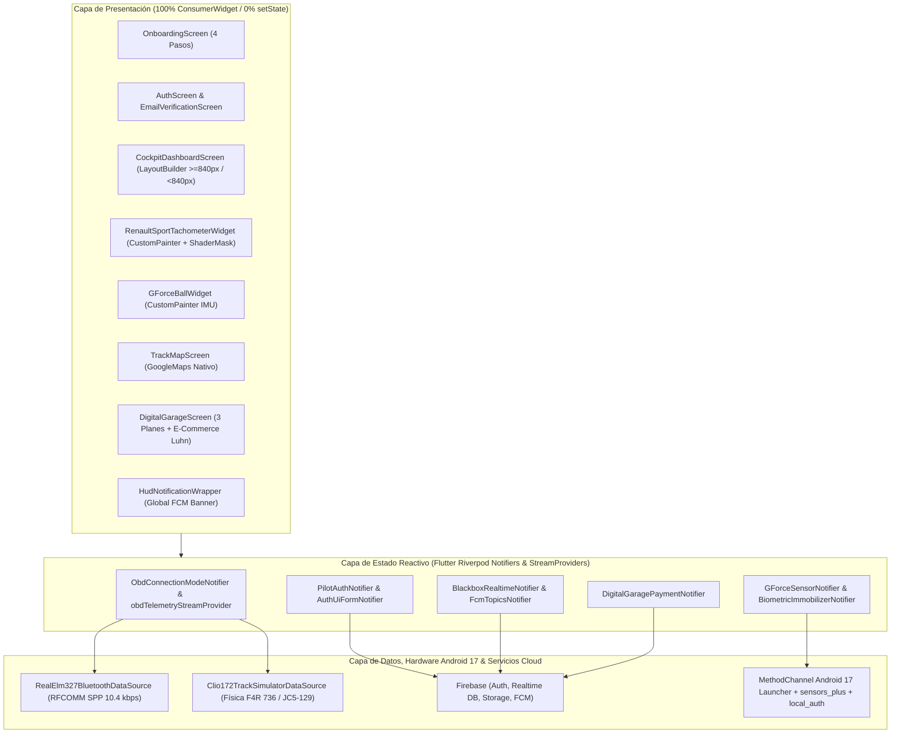
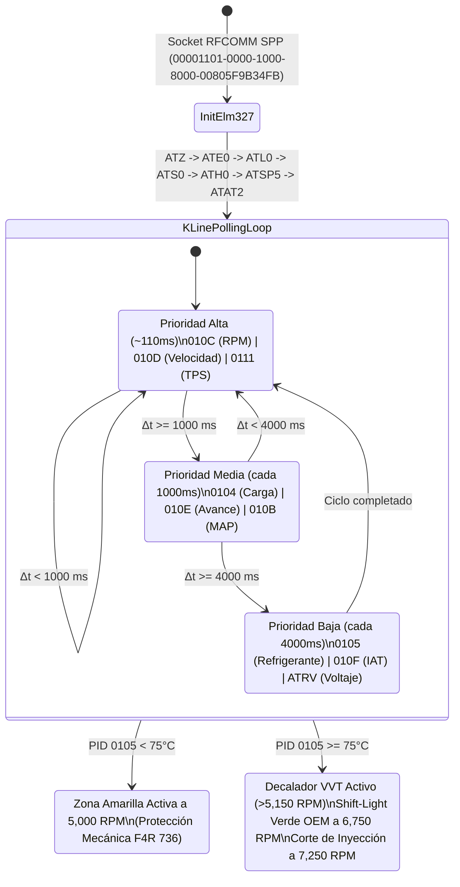
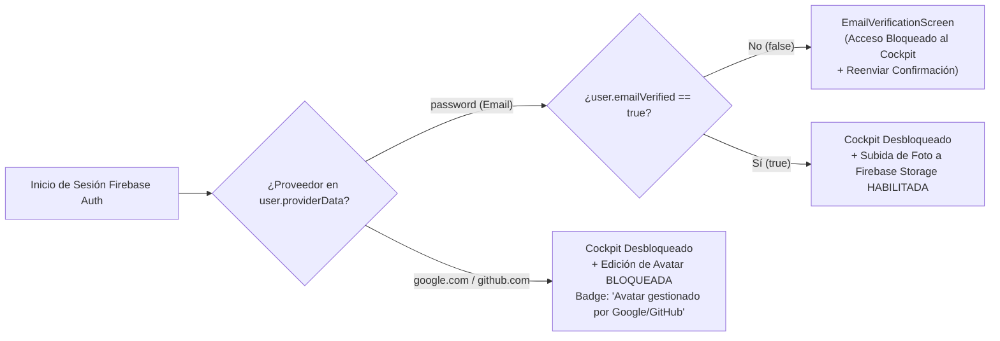
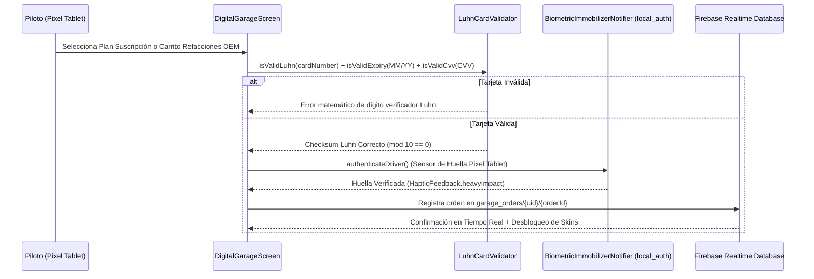

# REPORTE TÉCNICO ACADÉMICO: CLIO RS 172 COCKPIT & TELEMETRY HUB

**Proyecto Universitario de Ingeniería de Software Automotriz & Sistemas Embebidos**  
**Vehículo Objetivo:** Renault Clio II Sport "172" Fase 2 (2004) — Motor F4R 736 (2.0L 16v, 172 PS)  
**Unidad de Control de Motor (ECU):** Siemens Sirius 34 (`ISO 14230-4 KWP2000` sobre Línea K, Pin 7 OBD-II, 10.4 kbps)  
**Plataforma de Hardware Objetivo:** Google Pixel Tablet (2560×1600, relación 16:10) corriendo **Android 17 (API 36)** en modo **Android Car Launcher (`HOME` / `DEFAULT`)**  
**Arquitectura de Estado:** 100% Flutter Riverpod (`Notifier`, `AsyncNotifier`, `StreamProvider`) — **0% `setState` / 0% `ValueNotifier`**

---

## 1. Planteamiento del Problema

El **Renault Clio II Sport 172 Fase 2 (2004)** es un referente histórico del segmento *Hot Hatch* europeo gracias a su motor atmosférico **F4R 736 de 2.0 litros y 16 válvulas** con distribución variable (**VVT Cam Dephaser**) y chasis ligero. Sin embargo, su arquitectura electrónica de transición (principios de los años 2000) presenta tres desafíos técnicos críticos para el conductor de circuito y entusiasta moderno:

1. **Cuello de Botella en el Bus de Diagnóstico (Línea K a 10.4 kbps):** A diferencia de los vehículos modernos con bus CAN de alta velocidad (500 kbps), la ECU **Siemens Sirius 34** se comunica por el **Pin 7 del conector OBD-II (Línea K)** bajo el protocolo **ISO 14230-4 KWP2000**. Este bus serial entrega únicamente entre **5 y 10 respuestas por segundo**. Los clientes OBD-II genéricos solicitan todos los PIDs secuencialmente sin priorización, provocando una caída de la tasa de refresco del tacómetro a menos de 2 Hz.
2. **Protección Mecánica en Frío y Gestión del Decalador VVT:** El motor F4R 736 incorpora un mapa de protección en la ECU Siemens Sirius 34 que limita el giro recomendado a **5,000 RPM** mientras la temperatura del refrigerante (`PID 0105`) es inferior a **75°C**. Una vez alcanzada la temperatura operativa ($\ge 75^\circ\text{C}$), la ECU habilita el solenoide decalador del árbol de levas a partir de **5,150 RPM**, enciende el testigo verde de cambio óptimo (*OEM Green Shift-Light*) a las **6,750 RPM** y sitúa el corte de inyección en **7,250 RPM**. El cuadro de instrumentos Sagem original carece de telemetría numérica exacta de presión de colector (MAP), avance de encendido, posición de mariposa (TPS) y registro en la nube.
3. **Integración Nativa en Cabina como Launcher Automotriz:** Las aplicaciones móviles convencionales no operan como *Home Screen* nativo en Android 17 ni integran telemetría inercial (fuerzas G filtradas), navegación GPS nativa sin *WebViews*, seguridad biométrica ni comercio electrónico de refacciones específicas en una sola interfaz libre de bloqueos.

---

## 2. Objetivo General y Objetivos Específicos

### 2.1 Objetivo General
Desarrollar desde cero una suite de telemetría automotriz en tiempo real y **Android 17 Car Launcher** en **Flutter** para la **Google Pixel Tablet (2560×1600)**, capaz de comunicarse con la ECU **Siemens Sirius 34** mediante un adaptador **ELM327 original** bajo protocolo **KWP2000**, cumpliendo al 100% con una arquitectura reactiva pura en **Riverpod** (cero `setState` y cero `ValueNotifier`).

### 2.2 Objetivos Específicos
1. **Diseñar una Cola de Prioridad K-Line (`Sirius34KwpParser` + `RealElm327BluetoothDataSource`)** que maximice el ancho de banda de 10.4 kbps dividiendo el *polling* en tres frecuencias: Alta (~110 ms para RPM, Velocidad y TPS), Media (1,000 ms para Carga, Avance y MAP) y Baja (4,000 ms para Refrigerante, IAT y Voltaje).
2. **Construir un Simulador Físico de Circuito (`Clio172TrackSimulatorDataSource`)** intercambiable en caliente mediante polimorfismo (`ObdDataSource`), permitiendo evaluar en el aula universitaria el calentamiento progresivo del motor (65°C a 92°C), aceleraciones de 1ra a 5ta marcha (caja JC5-129) y maniobras de punta-tacón.
3. **Implementar Innovación en UI a 120 FPS** mediante `CustomPainter` y `ShaderMask` en los widgets `RenaultSportTachometerWidget` y `GForceBallWidget`, siguiendo el lenguaje de diseño *"Renault Sport 2004 Phase 2 Reforged"* con modos Oscuro (*Night Stage Sagem Amber*) y Claro (*Daylight Cup Mondial Blue*).
4. **Integrar el Ecosistema Completo de Firebase:**
   - **Authentication:** Correo/Contraseña (con bloqueo obligatorio si `emailVerified == false`), Google Sign-In y GitHub Auth, aplicando la regla estricta de negocio que restringe el cambio de foto de perfil exclusivamente a cuentas de correo (`password`).
   - **Storage & Caché Offline:** Almacenamiento de avatares con `cached_network_image`, `shared_preferences` y `hive`.
   - **Realtime Database ("Blackbox Live"):** Sincronización de picos de RPM, velocidad máxima, tiempos 0-100 km/h e historial de códigos DTC (Modo `03`).
   - **Cloud Messaging (FCM):** Ciclo de vida en los 3 estados (primer plano, segundo plano y terminado), suscripción reactiva a temas (`Topics`) y banner HUD global.
5. **Integrar Hardware Nativo y Pasarela de Pagos:** Sensores IMU (`sensors_plus`) con filtro de paso bajo, biometría (`local_auth`), mapas nativos (`google_maps_flutter`) y módulo de suscripciones + E-Commerce con validación matemática por **Algoritmo de Luhn**.

---

## 3. Alcance y Arquitectura de Software

### 3.1 Diagrama de Arquitectura General (Clean Architecture + Riverpod Puro)

---

## 4. Ingeniería del Protocolo OBD-II KWP2000 (ECU Siemens Sirius 34)

### 4.1 Secuencia de Inicialización para Chips ELM327 Originales (v1.4b/v1.5/v2.3)
Para establecer enlace sobre la **Línea K (Pin 7)** con la ECU Siemens Sirius 34 y minimizar el *overhead* de bytes ASCII por trama, `RealElm327BluetoothDataSource` ejecuta la siguiente secuencia determinista:

| Orden | Comando AT | Función Técnica en el Microcontrolador ELM327 |
| :--- | :--- | :--- |
| 1 | `ATZ` | Reinicio completo del intérprete ELM327 y verificación de firma de silicio genuino. |
| 2 | `ATE0` | Desactiva el eco local (*Echo Off*), reduciendo a la mitad los bytes transmitidos por UART/RFCOMM. |
| 3 | `ATL0` | Suprime caracteres de salto de línea `\n` (*Linefeeds Off*). |
| 4 | `ATS0` | Suprime espacios en blanco entre bytes hexadecimales (`410C1AF8` en lugar de `41 0C 1A F8`). |
| 5 | `ATH0` | Oculta las cabeceras de dirección KWP2000 durante el *polling* cíclico de Modo `01`. |
| 6 | `ATSP5` | Fija el protocolo en **ISO 14230-4 KWP2000 (Fast Init, 10.4 kbaud)** con *fallback* automático a `ATSP4` (5-Baud Slow Init). |
| 7 | `ATAT2` | Activa el *Adaptive Timing* agresivo soportado por chips ELM327 genuinos para reducir el tiempo de espera entre tramas K-Line. |

### 4.2 Máquina de Estados de la Cola de Prioridad K-Line y Shift-Light OEM

---

## 5. Procesamiento Matemático de Sensores Nativos y Validación

### 5.1 Filtro de Paso Bajo Exponencial (EMA) para Fuerzas G (`sensors_plus`)
El soporte de tablero en un Clio RS 172 con suspensión rígida transmite vibraciones de alta frecuencia del motor F4R a la Google Pixel Tablet. Para evitar que la esfera del `GForceBallWidget` oscile erráticamente, `GForceSensorNotifier` aplica un filtro de paso bajo discreto de primer orden con factor de suavizado $\alpha = 0.18$:

$$G_{\text{filtrado}}[k] = G_{\text{filtrado}}[k-1] + \alpha \cdot \left( \frac{a_{\text{raw}}[k]}{g_0} - G_{\text{filtrado}}[k-1] \right), \quad g_0 = 9.80665\,\text{m/s}^2$$

La magnitud vectorial instantánea se calcula mediante:

$$\|G\| = \sqrt{G_{\text{lat}}^2 + G_{\text{lon}}^2}$$

### 5.2 Regla de Seguridad de Firebase Auth y Edición de Avatar

### 5.3 Secuencia de Checkout con Algoritmo de Luhn y Biometría (`local_auth`)

---

## 6. Estrategia de Ramas y Commits Semánticos para GitHub

Para mantener una trazabilidad académica e industrial impecable en el repositorio de GitHub, el desarrollo se estructura bajo **GitFlow Simplificado** (`main`, `develop` y ramas `feature/*`) utilizando la especificación **Conventional Commits**:

1. `chore(project): initialize flutter 3.22 project and configure Android 17 (API 36) launcher manifest`
   - Configuración de `pubspec.yaml`, categorías `HOME` y `DEFAULT` en `AndroidManifest.xml`, permisos `BLUETOOTH_SCAN` (`neverForLocation`), `BLUETOOTH_CONNECT`, `FOREGROUND_SERVICE_CONNECTED_DEVICE` y `MainActivity.kt` con `MethodChannel`.
2. `feat(theme): implement Renault Sport 2004 Phase 2 Reforged design system with Riverpod`
   - Creación de `app_theme.dart` y `theme_provider.dart` con temas *Night Stage (Sagem Amber `#FF6B00`)* y *Daylight Cup (Mondial Blue `#0038A8`)* y tipografías tabulares `Chakra Petch`, `Orbitron` y `Exo 2`.
3. `feat(obd-kwp2000): add polymorphic ObdDataSource for Siemens Sirius 34 ECU and track simulator`
   - Implementación de `elm327_service.dart` con secuencia `ATZ -> ATE0 -> ATL0 -> ATS0 -> ATH0 -> ATSP5 -> ATAT2`, cola de prioridad de 3 niveles y simulador físico de circuito.
4. `feat(ui-gauges): build 120fps RenaultSportTachometerWidget and GForceBallWidget using CustomPainter`
   - Implementación del tacómetro radial Sagem con `ShaderMask`, zona roja dinámica (5,000 RPM frío vs 6,750/7,250 RPM caliente), testigo OEM de palanca de cambios y medidor vectorial de fuerzas G con filtro de paso bajo.
5. `feat(firebase): integrate Auth security gates, provider-locked Storage avatar, Blackbox DB and FCM HUD`
   - Integración de Email/Google/GitHub Auth, bloqueo por `emailVerified == false`, restricción de subida de avatar exclusiva para cuentas `password`, caché offline con `CachedNetworkImage` y notificaciones Push FCM en los 3 estados con `Topics`.
6. `feat(maps-payments): add native Google Maps track view and Luhn-validated Digital Garage payment suite`
   - Integración de `google_maps_flutter` nativo con talleres especialistas Renault Sport, 3 planes de suscripción, catálogo E-Commerce de refacciones F4R y autorización biométrica con `local_auth`.
7. `docs(report): add academic technical report with Mermaid diagrams and KWP2000 specification`
   - Documentación integral en `REPORTE_TECNICO.md`.

