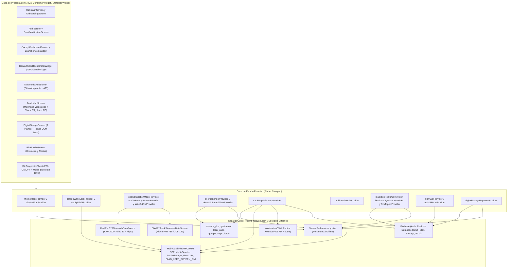
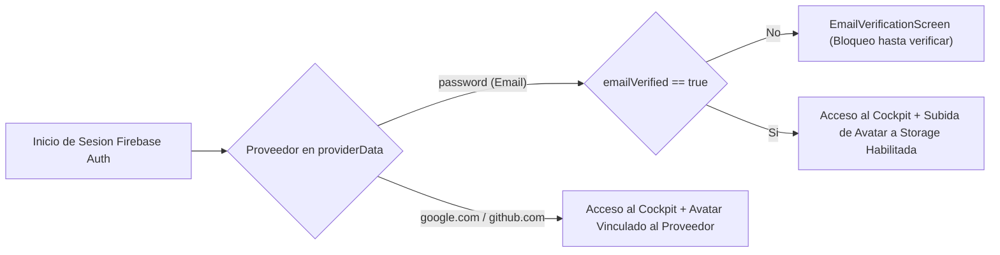
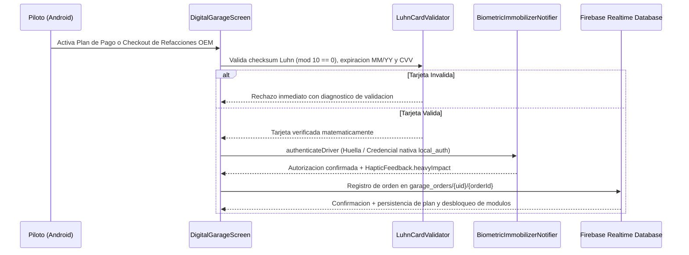
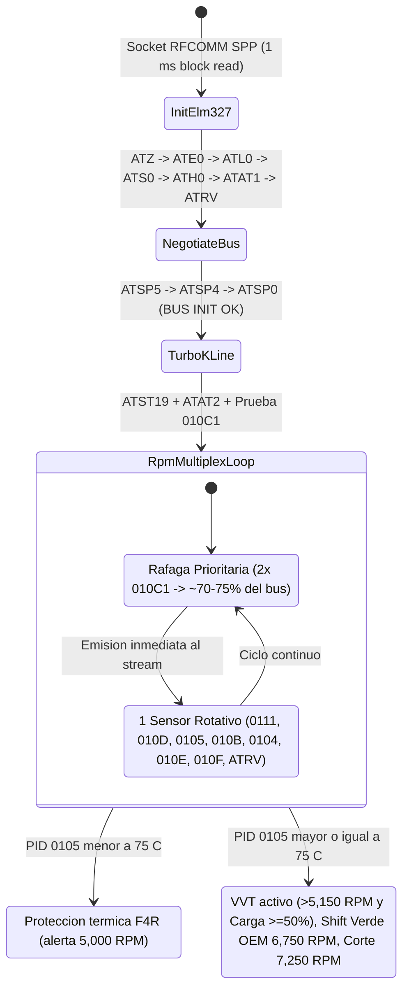

# DOCUMENTACIÓN TÉCNICA (REPORTE): RS DIGITAL COCKPIT

**Proyecto de Ingeniería de Software Automotriz, Telemetría Embebida e Interfaz en Cabina**  
**Aplicación:** `RS Digital Cockpit` | **Paquete Android:** `com.rs.digital.cockpit` | **Versión:** `2.0.4+172`  
**Vehículo Objetivo:** Renault Clio II Sport "172" Fase 2 (2004) — Motor **F4R 736** (2.0L 16v, 172 PS), Caja **JC5-129**  
**Unidad de Control de Motor (ECU):** Siemens Sirius 34 (`ISO 14230-4 KWP2000` sobre Línea K, Pin 7 OBD-II a 10.4 kbps)  
**Hardware Objetivo:** Google Pixel Tablet (2560×1600, Android 17 / API 36, modo Car Launcher `HOME`/`DEFAULT`) y smartphones Android (diseño 100% responsivo)  
**Arquitectura de Estado:** 100% Flutter Riverpod (`Notifier`, `AsyncNotifier`, `StreamProvider`) — 0% `setState`, 0% `ValueNotifier`, 0% `StatefulWidget`

---

## 1. Planteamiento del Proyecto

### 1.1 Contexto y Problemática
El **Renault Clio II Sport 172 Fase 2 (2004)** es un referente mecánico dentro del segmento *Hot Hatch* europeo debido a su motor atmosférico **F4R 736 de 2.0 litros y 16 válvulas** con decalador variable de árbol de levas (**VVT**), baja relación peso/potencia y transmisión manual **JC5-129**. No obstante, su arquitectura electrónica pertenece a una etapa previa a la masificación del bus CAN de alta velocidad y del infoentretenimiento conectado, lo que genera cuatro problemas técnicos concretos para el conductor entusiasta y de circuito:

1. **Restricción de ancho de banda en el bus serial K-Line (10.4 kbps):** La ECU **Siemens Sirius 34** opera mediante **ISO 14230-4 KWP2000** sobre el Pin 7 del conector OBD-II (Línea K). Frente a los 500 kbps del bus CAN moderno, la Línea K entrega entre **5 y 10 tramas por segundo**. Las aplicaciones OBD-II genéricas solicitan múltiples sensores secuencialmente sin priorización, congelando las lecturas de RPM y reduciendo la fluidez del tacómetro por debajo de 2 Hz.
2. **Fidelidad mecánica del motor F4R 736 y falta de telemetría extendida:** El cuadro analógico Sagem original no exhibe lecturas numéricas exactas de presión absoluta del colector (**MAP**), avance de encendido, carga calculada de la ECU, temperatura de admisión (**IAT**) ni historial en la nube. Además, la ECU aplica una **protección térmica en frío** que restringe el régimen recomendado a **5,000 RPM** por debajo de **75 °C**; una vez alcanzada la temperatura operativa ($\ge 75^\circ\text{C}$), habilita el solenoide **VVT** a partir de **5,150 RPM**, enciende el testigo verde OEM de cambio óptimo a **6,750 RPM** y ejecuta el corte de inyección a **7,250 RPM**.
3. **Fragmentación en cabina y ergonomía de conducción:** Utilizar aplicaciones separadas para telemetría OBD-II, reproductor de música, navegación GPS y registro de vueltas obliga a alternar ventanas mientras se conduce, genera conflictos de Bluetooth entre el adaptador OBD-II y el audio del vehículo, permite que la pantalla entre en reposo durante la marcha y produce interfaces poco legibles tanto en tablets en tablero como en teléfonos en vertical.
4. **Ausencia de trazabilidad de sesiones, mantenimiento y seguridad:** Los escáneres convencionales no vinculan los recorridos ni las vueltas cronometradas a la cuenta del piloto en la nube, no integran un odómetro automático que dispare alertas de mantenimiento específicas del motor F4R (aceite 5W40, bujías NGK PFR6E-10, kit de distribución + polea VVT) ni protegen operaciones críticas (borrado de códigos DTC Modo `04`, pagos y activación de planes) mediante autenticación biométrica nativa.

### 1.2 Objetivo General
Diseñar, construir y validar **RS Digital Cockpit**, una plataforma móvil y *Car Launcher* para Android desarrollada en **Flutter 3 / Dart 3** con puente nativo en **Kotlin**, que integre telemetría OBD-II KWP2000 optimizada en tiempo real para la ECU **Siemens Sirius 34**, centro multimedia nativo, navegación GPS con cálculo de rutas y cronómetro de vueltas, sensores inerciales, seguridad biométrica y sincronización en **Firebase**, manteniendo un cumplimiento estricto de arquitectura reactiva pura en **Flutter Riverpod**.

### 1.3 Objetivos Específicos
- **Optimizar la comunicación OBD-II sobre Línea K (10.4 kbps)** mediante inicialización determinista del adaptador ELM327, negociación escalonada de protocolo (`ATSP5` → `ATSP4` → `ATSP0`), modo de trama única (`010C1` + `ATST19` + `ATAT2`), lectura nativa por bloques (`1 ms`) y un multiplexor que asigna ~70–75% del bus a las RPM.
- **Incorporar un Simulador Físico Polimórfico (`ObdDataSource`)** fiel a las relaciones de caja **JC5-129** y a la curva térmica del **F4R 736**, permitiendo pruebas y demostraciones completas fuera del automóvil.
- **Construir una interfaz automotriz a 120 FPS y 100% responsiva** inspirada en *"Renault Sport 2004 Phase 2 Reforged"*, con temas **Oscuro (*Night Stage*)**, **Claro (*Daylight Cup*)** y **Automático (Sistema Android)**, libre de desbordamientos (`RenderFlex overflowed`) tanto en Pixel Tablet (2560×1600) como en smartphones Android.
- **Integrar los subsistemas nativos de Android** (`BluetoothSocket` RFCOMM SPP, `MediaSessionManager`, `NotificationListenerService`, `AudioManager` silencioso, `Geocoder`, `FLAG_KEEP_SCREEN_ON`, `sensors_plus`, `local_auth`, `geolocator` y `google_maps_flutter`).
- **Consolidar el ecosistema Cloud y reglas de negocio** con Firebase Auth (Email con verificación obligatoria, Google Sign-In y GitHub OAuth), Firebase Storage, Firebase Realtime Database (**Blackbox Cloud**, **Track Laps** y órdenes de **Garage**), notificaciones del sistema Android (FCM + `flutter_local_notifications`), tres niveles de suscripción persistentes y pasarela validada con **Algoritmo de Luhn (ISO/IEC 7812)**.

### 1.4 Alcance Funcional (6 Módulos Principales)

| Módulo | Pantalla / Controlador Principal | Responsabilidad Funcional |
| :--- | :--- | :--- |
| **Splash & Onboarding** | `RsSplashScreen`, `OnboardingScreen` | Secuencia de arranque con rombo vectorial Renault Sport e inducción guiada de 4 pasos persistida localmente. |
| **1. `COCKPIT`** | `CockpitDashboardScreen`, `RenaultSportTachometerWidget`, `GForceBallWidget` | Tacómetro radial Sagem 120 FPS con Shift-Light frío/caliente, parámetros F4R (básicos + extendidos Plan 2+), **Blackbox Cloud** con visor e historial sincronizado, monitor de Fuerzas G calibrable (Plan 3) y **minimapa en vivo tipo videojuego** con espejo de ruta activa. |
| **2. `MULTIMEDIA`** | `MultimediaHubScreen`, `RsMediaNotificationListenerService` | Reproductor conectado al sistema Android (`MediaSessionManager`), carátula a fondo completo con filtro translúcido adaptable al tema activo, controles ampliados (`Random`, `Anterior`, `Play/Pausa`, `Siguiente`, `Repeat`), barra `seekTo`, volumen silencioso y atenuación rápida **`ATT`**. |
| **3. `TRACK`** | `TrackMapScreen`, `TrackMapTelemetryNotifier` | Mapa nativo (2/3) con filtros cercanos reales (**Talleres**, **Gasolineras**, **Estacionamientos**) vía Nominatim + Photon, trazado de ruta vehicular azul vía **OSRM**, y cronómetro automático de **Laps GPS** (1/3, Plan 3) con geofencing y carga a Firebase por nombre de calle. |
| **4. `GARAGE`** | `DigitalGarageScreen`, `DigitalGaragePaymentNotifier` | 3 planes funcionales persistentes (`RS Clubman` Gratis, `RS Cup Telemetry` \$99 MXN/mes, `RS Trophy Pro` \$899 MXN/año), desbloqueo de skins (`Sagem OEM`, `Jean Ragnotti`, `Clio V6`), catálogo de refacciones OEM F4R y checkout con **Luhn + biometría**. |
| **5. `ACCOUNT`** | `PilotProfileScreen`, `PilotAuthNotifier`, `FcmTopicsNotifier` | Perfil multi-proveedor (foto editable exclusivamente en cuentas `password`), **odómetro automático (GPS + OBD-II `010D`)**, ajuste manual y alertas nativas Android por kilometraje de servicio (Plan 2+). |
| **6. `ECU`** | `DtcDiagnosticSheet`, `ObdConnectionModeNotifier`, `RealElm327BluetoothDataSource` | Switch maestro **`ECU ON / OFF`** persistido, selector modal desplegable de dispositivos Bluetooth vinculados, switch de simulador F4R, lectura real Modo `03` y borrado biométrico Modo `04` de DTCs (Plan 3), más monitor serial KWP2000 en vivo. |

---

## 2. Arquitectura de Software

### 2.1 Patrón Arquitectónico y Regla de Estado Reactivo
El proyecto adopta una **Arquitectura Limpia organizada por funcionalidades (*Feature-First Clean Architecture*)** combinada con **gestión de estado reactiva pura mediante Flutter Riverpod (`flutter_riverpod ^2.6.1`)**:

- **Capa de Presentación (`screens/` y `widgets/`):** Compuesta exclusivamente por `ConsumerWidget` y `StatelessWidget`. Ninguna vista almacena lógica de negocio ni estado mutable local; toda reconstrucción se dispara selectivamente con `ref.watch` y `.select(...)` para minimizar el costo de renderizado a 120 FPS.
- **Capa de Estado Reactivo (`providers/` y `Notifier`):** Centraliza cada dominio en clases inmutables de estado (`ObdTelemetryFrame`, `ObdAdapterState`, `TrackMapTelemetryState`, `GForceTelemetryState`, `MultimediaHubState`, `DigitalGaragePaymentState`, `FcmTopicsState`, `BlackboxCloudRecord`) gestionadas mediante `Notifier`, `AsyncNotifier` y `StreamProvider`.
- **Capa de Datos, Hardware Nativo y Cloud (`services/` y `MainActivity.kt`):** Aísla la comunicación por `MethodChannel` con Android, los sockets RFCOMM Bluetooth, el acceso a sensores IMU/GPS, los clientes HTTP hacia APIs abiertas (Nominatim, Photon, OSRM) y los servicios de Firebase.
- **Cumplimiento estricto verificado:** 0 instancias de `setState`, `ValueNotifier` o `StatefulWidget` en la totalidad del árbol `lib/**/*.dart`.

### 2.2 Diagrama de Arquitectura General



### 2.3 Estructura Modular del Código Fuente

```text
lib/
├── main.dart                                   # Arranque, Firebase, ProviderScope, RsDigitalCockpitApp y wake lock
├── firebase_options.dart                       # Opciones Android del proyecto rs-digital-cockpit
├── core/
│   ├── launcher/car_launcher_service.dart      # Puente para apps externas y selector de Home Launcher
│   └── theme/
│       ├── app_theme.dart                      # Paleta Renault Sport 2004, estilos tabulares y ClusterSkinEdition
│       └── theme_provider.dart                 # ThemeModeNotifier (Auto/Oscuro/Claro) y ClusterSkinNotifier
└── features/
    ├── splash/rs_splash_screen.dart            # Rombo vectorial Renault Sport y secuencia de arranque
    ├── onboarding/                             # Onboarding interactivo de 4 pasos (onboarding_provider/screen)
    ├── auth_profile/                           # PilotProfile, PilotAuthNotifier, Auth/Verify/Recovery/Account
    ├── cockpit_dashboard/
    │   ├── cockpit_dashboard_screen.dart       # Cabecera, selector de tema, vistas Tablet/Teléfono e Historial Blackbox
    │   └── widgets/
    │       ├── launcher_dock_widget.dart       # Dock inferior auto-adaptable (texto+icono / solo-iconos) + ScreenWakeLockNotifier
    │       └── dtc_diagnostic_sheet.dart       # ECU ON/OFF, selector modal Bluetooth, DTC Sirius 34 y monitor serial
    ├── telemetry/
    │   ├── models/obd_telemetry_frame.dart     # ObdTelemetryFrame, ShiftLightStage y Sirius34DtcFault
    │   ├── providers/telemetry_providers.dart  # Estado OBD2, stream telemetría, estadísticas 0-100 y DTC AsyncNotifier
    │   ├── services/elm327_service.dart        # Contrato ObdDataSource, Sirius34KwpParser, ELM327 real y Simulador F4R
    │   └── widgets/                            # RenaultSportTachometerWidget y GForceBallWidget (CustomPainter)
    ├── multimedia/multimedia_hub_screen.dart   # MediaSession, filtro de carátula por tema, volumen silencioso y ATT
    ├── map_track/                              # TrackMapTelemetryNotifier (GPS/OSRM/Laps) y TrackMapScreen
    ├── digital_garage_payments/                # Modelos de planes/Luhn, DigitalGaragePaymentNotifier y UI Garage
    ├── cloud_sync_fcm/                         # BlackboxRealtimeNotifier (REST+SDK), FcmTopicsNotifier y HudNotificationWrapper
    └── sensors/                                # GForceSensorNotifier (IMU + calibración) y BiometricImmobilizerNotifier
android/app/src/main/kotlin/com/rs/digital/cockpit/
└── MainActivity.kt                             # RsMediaNotificationListenerService, RFCOMM, AudioManager, Geocoder y WakeLock
```

### 2.4 Diseño de Temas, Polimorfismo y Reglas de Negocio

#### Sistema Visual *"Renault Sport 2004 Phase 2 Reforged"*
- **Tres modos de tema persistidos (`ThemeModeNotifier`):** `ThemeMode.system` (sigue automáticamente el tema claro/oscuro de Android), `ThemeMode.dark` (*Night Stage*: fondo carbón `#0F1115`, antracita `#1C2026`, ámbar Sagem `#FF6B00`, amarillo Sirius `#FFD100`) y `ThemeMode.light` (*Daylight Cup*: plata Iceberg `#E8ECEF`, blanco puro `#FFFFFF`, azul Mondial `#0038A8`, rojo aguja `#E11D48`).
- **Estabilidad tipográfica a 120 FPS:** Todas las lecturas dinámicas emplean `FontFeature.tabularFigures()` con `Chakra Petch` y `Orbitron`, evitando desplazamientos horizontales de dígitos durante cambios rápidos de RPM o cronometraje.
- **Adaptación responsiva multi-dispositivo:**
  - En tablet apaisada (`>= 840 × 480`), Cockpit utiliza un tablero de 3 columnas (`Parámetros + Blackbox` | `Tacómetro 120 FPS` | `G-Force + Minimapa`).
  - En smartphones, Cockpit pasa a columna desplazable con tacómetro de altura proporcional y compartimentos acotados que impiden solapamientos, `LauncherDockWidget` mide con `TextPainter` el ancho requerido y conmuta automáticamente a **solo iconos** cuando las 6 etiquetas exceden la pantalla, Multimedia compacta su barra ocultando el porcentaje en vertical, y Track/Account adaptan sus contenedores eliminando todo desbordamiento.

#### Seguridad en Autenticación y Control de Acceso por Suscripción



- **Planes persistentes en `SharedPreferences` (`rs_active_subscription_tier` y `rs_active_cluster_skin`):**
  - **Plan 1 — `RS Clubman` (Gratis):** Telemetría básica K-Line (`010C`, `010D`, `0105`, `0111`), Shift-Light frío/caliente, Blackbox Cloud y Simulador F4R.
  - **Plan 2 — `RS Cup Telemetry` (\$99 MXN/mes):** Desbloquea PIDs extendidos Sirius 34 (`MAP 010B`, `Avance 010E`, `Carga 0104`) y alertas automáticas de mantenimiento por kilometraje.
  - **Plan 3 — `RS Trophy Pro` (\$899 MXN/año):** Desbloquea skins exclusivos (*Clio V6 255 Titanium* y *172 Cup / Jean Ragnotti*), Cronómetro de Laps GPS, Monitor de Fuerzas G y diagnóstico/borrado biométrico de DTCs (Modo `03`/`04`).



---

## 3. Uso de Sensores y Componentes

### 3.1 Matriz de Sensores, Hardware Nativo y Servicios Integrados

| Subsistema / Sensor | Paquete / API Nativa Android | Frecuencia / Canal | Procesamiento y Función en la App |
| :--- | :--- | :--- | :--- |
| **Bus OBD-II ELM327 (Línea K)** | `BluetoothSocket` RFCOMM SPP (`00001101-0000-1000-8000-00805F9B34FB`) | Canal `com.renaultsport.clio172/rfcomm`, lectura en bloques cada `1 ms` | Handshake KWP2000, multiplexor RPM (~70–75% ancho de banda), decodificación Modo `01`/`03`, borrado Modo `04` y switch `ECU ON/OFF`. |
| **Acelerómetro y Giroscopio (IMU)** | `sensors_plus` (`accelerometerEventStream`, `gyroscopeEventStream`) | `SensorInterval.gameInterval` (~50 Hz) | Conversión a G ($g_0 = 9.80665\,\text{m/s}^2$), calibración persistente de punto cero (`CALIBRAR`), filtro paso bajo EMA ($\alpha = 0.20$), zona muerta (`0.02 G`), estela de 18 puntos y velocidad angular yaw (°/s). |
| **Receptor GPS de Alta Precisión** | `geolocator` (`AndroidSettings`) | `intervalDuration: 400 ms`, `distanceFilter: 0` | Seguimiento estilo videojuego en minimapa (posición, rumbo `bearing`, velocidad), odómetro automático Haversine y geofencing de vueltas (`> 35 m` / `< 25 m`). |
| **Mapas Nativos, Geocodificación y Ruteo** | `google_maps_flutter`, Android `Geocoder`, Nominatim OSM, Photon Komoot, OSRM | Bajo demanda + refresco de calle cada `15 s` | Mapa oscuro/claro según tema, búsqueda de Talleres/Gasolineras/Estacionamientos reales, cálculo de ruta vehicular azul (`Polyline`) reflejada en Track y Cockpit, y nombrado de sesiones de laps por calle real. |
| **Sesión Multimedia y Volumen del Sistema** | `MediaSessionManager`, `RsMediaNotificationListenerService`, `AudioManager` | Sondeo `700 ms` + BroadcastReceiver Spotify/Music | Extracción y compresión JPEG (máx. 600 px) de carátulas (`Bitmap`, `content://`, `https://`), transporte multimedia (`play_pause`, `next`, `previous`, `seekTo`, `shuffle`, `repeat`), slider silencioso (`flags = 0`) y atenuación `ATT`. |
| **Sensor Biométrico y Háptica** | `local_auth`, `HapticFeedback` | Bajo demanda en acciones críticas | Compuerta biométrica nativa para activar planes de pago, confirmar compras OEM y ejecutar borrado de códigos DTC Modo `04`. |
| **Gestión de Pantalla (Wake Lock)** | `WindowManager.LayoutParams.FLAG_KEEP_SCREEN_ON` | Canal `com.renaultsport.clio172/launcher` (`setKeepScreenOn`) | Mantiene la pantalla permanentemente encendida en `COCKPIT`, `MULTIMEDIA` y `ECU`; permite el reposo automático en `TRACK`, `GARAGE`, `ACCOUNT` y pantallas de acceso. |
| **Notificaciones Nativas y Nube** | `flutter_local_notifications`, `firebase_messaging`, `firebase_auth`, `firebase_database`, `firebase_storage` | Eventos en vivo + caché `SharedPreferences` / `Hive` | Alertas del sistema Android por intervalos de mantenimiento F4R, sincronización automática de Blackbox Cloud (REST con auto-detección regional + `onValue` en vivo) y subida de Track Laps. |

### 3.2 Ingeniería del Protocolo OBD-II KWP2000 (ECU Siemens Sirius 34)

#### Secuencia de Inicialización y Modo Turbo K-Line
En `RealElm327BluetoothDataSource` (`lib/features/telemetry/services/elm327_service.dart`), la conexión RFCOMM se gestiona en un hilo dedicado (`ioExecutor` con `ioLock` en `MainActivity.kt`) y los comandos desde Dart pasan por una cola serializada (`_serialLock`) que evita colisiones entre el bucle de telemetría y diagnósticos Modo `03`/`04`:

1. **Inicialización segura ELM327:** `ATZ` (reset, espera `2500 ms` + `350 ms`) → `ATE0` (sin eco) → `ATL0` (sin saltos de línea) → `ATS0` (sin espacios entre bytes hex) → `ATH0` (sin cabeceras) → `ATAT1` (*Adaptive Timing* estándar).
2. **Lectura inmediata de voltaje (`ATRV`):** Obtiene la tensión de batería del Pin 16 OBD-II incluso antes de iniciar el bus K-Line.
3. **Negociación escalonada de protocolo:** Intenta `ATSP5` (**ISO 14230-4 KWP2000 Fast Init**, `4500 ms`) → fallback `ATSP4` (**5-Baud Slow Init**, `5500 ms`) → fallback `ATSP0` (detección automática multi-protocolo, `6500 ms`) validando respuesta real a `010C`.
4. **Optimización post-init (Modo Turbo K-Line):** Una vez activa la ECU, reduce el tiempo de espera post-trama a `100 ms` (`ATST19`), activa *Adaptive Timing* agresivo (`ATAT2`) y verifica el soporte del sufijo de respuesta única **`010C1`**, evitando que el ELM327 espere `200 ms` adicionales por una segunda ECU inexistente y duplicando la tasa de refresco real de RPM.

#### Multiplexor de Prioridad y Fórmulas de Decodificación (`Sirius34KwpParser`)
Para impedir que la lectura de sensores lentos congele la aguja del tacómetro, el bucle ejecuta ráfagas de **2 lecturas consecutivas de RPM (`010C1`) por cada 1 sensor secundario en rotación** (`0111`, `010D`, `0105`, `010B`, `0104`, `010E`, `010F`, `ATRV`), emitiendo cada muestra inmediatamente al stream:

| Comando / PID | Parámetro | Fórmula de Decodificación | Uso en RS Digital Cockpit |
| :--- | :--- | :--- | :--- |
| `010C` / `010C1` | Revoluciones (RPM) | $\text{RPM} = \frac{(A \times 256) + B}{4}$ | Tacómetro 120 FPS, Shift-Light inteligente, VVT y marcha JC5-129. |
| `010D` | Velocidad vehículo | $v = A \text{ (km/h)}$ | Velocímetro digital, cálculo 0–100 km/h e integración de odómetro ($\Delta d = v \cdot \Delta t / 3600$). |
| `0111` | Posición mariposa (TPS) | $\text{TPS} = \frac{A \times 100}{255}\%$ | Parámetro F4R en vivo y detección de salida 0–100 km/h. |
| `0105` | Temperatura refrigerante | $T_{\text{ECT}} = A - 40\,(^\circ\text{C})$ | Conmutación automática Mapa Frío ($<75^\circ\text{C}$) vs Caliente ($\ge 75^\circ\text{C}$). |
| `010B` | Presión colector (MAP) | $\text{MAP} = A \text{ (kPa)}$ | Telemetría extendida Sirius 34 (Plan 2+). |
| `010E` | Avance de encendido | $\theta = \frac{A}{2} - 64^\circ$ | Telemetría extendida Sirius 34 (Plan 2+). |
| `0104` | Carga calculada motor | $\text{Carga} = \frac{A \times 100}{255}\%$ | Telemetría extendida Sirius 34 (Plan 2+) y condición de activación VVT ($\ge 50\%$). |
| `010F` | Temperatura aire admisión (IAT) | $T_{\text{IAT}} = A - 40\,(^\circ\text{C})$ | Tarjeta combinada Batería / IAT en Cockpit. |
| `ATRV` / `0142` | Voltaje de batería | Lectura directa `XX.XV` o $\frac{(A\times 256)+B}{1000}$ | Diagnóstico de alternador y batería del vehículo. |
| `03` / `04` | Códigos de falla DTC | Decodificación de pares hex tras `43` (`P`/`C`/`B`/`U`) con mapeo `DFxxx` Renault | Lectura real sin códigos falsos y borrado protegido con biometría (Plan 3). |



### 3.3 Procesamiento Matemático de Sensores Inerciales (IMU), Audio y GPS

#### Filtro EMA y Calibración de Fuerzas G (`GForceSensorNotifier`)
Las vibraciones del motor F4R y la suspensión deportiva del Clio RS 172 introducen ruido de alta frecuencia en el acelerómetro. `GForceSensorNotifier` aplica compensación del ángulo del soporte mediante el offset calibrado ($G_{0,\text{lat}}, G_{0,\text{lon}}$ persistidos en `SharedPreferences`) y un **filtro exponencial de paso bajo (EMA)** con $\alpha = 0.20$ y zona muerta de $0.02\,\text{G}$:

$$G_{\text{cal}}[k] = \text{clamp}\!\left(\frac{a_{\text{raw}}[k]}{g_0} - G_0,\;-1.8,\;1.8\right), \qquad g_0 = 9.80665\,\text{m/s}^2$$

$$G_{\text{filtrado}}[k] = G_{\text{filtrado}}[k-1] + 0.20 \cdot \left(G_{\text{cal}}[k] - G_{\text{filtrado}}[k-1]\right)$$

$$\|G\| = \sqrt{G_{\text{lat}}^2 + G_{\text{lon}}^2}$$

#### Atenuación Segura de Volumen (`ATT`) y Audio Silencioso
En `MultimediaHubNotifier`, el control de volumen invoca `AudioManager.setStreamVolume(..., flags = 0)` para omitir el popup nativo de Android sobre el tablero. Al pulsar **`ATT`**, el servicio consulta primero el paso discreto real del dispositivo (`getVolumeState`), guarda el porcentaje original exacto y calcula el paso atenuado garantizando matemáticamente que nunca suba el volumen aun en niveles bajos:

$$\text{targetStep} = \begin{cases} 0 & \text{si } s_{\text{actual}} \le 0 \\ \text{clamp}\!\left(\text{round}(0.25 \cdot s_{\text{actual}}),\;0,\;s_{\text{actual}} - 1\right) & \text{si } s_{\text{actual}} > 0 \end{cases}$$

#### Minimapa Estilo Videojuego, Ruteo OSRM y Geofencing de Laps
- **Minimapa en Cockpit:** El stream GPS en Android solicita actualizaciones cada `400 ms` (`distanceFilter: 0`). La cámara del minimapa se mueve y rota continuamente (`zoom: 17.2`, `tilt: 35°`, `bearing` actualizado cuando $v \ge 1.2\,\text{m/s}$) debajo de un indicador central fijo (`_CenteredVehicleBeacon`), proyectando además la línea azul (`Polyline`) cuando existe una ruta activa desde Track.
- **Ruteo abierto sin Places/Directions API:** Ante la ausencia de Places/Directions API en la clave de Maps, la búsqueda de lugares cercanos combina **OpenStreetMap Nominatim** (`viewbox` de $\sim 8\,\text{km}$) y **Photon Komoot** (filtrado a $\le 12\,\text{km}$), mientras que el cálculo de ruta vehicular consulta **OSRM** (`router.project-osrm.org` con respaldo `routing.openstreetmap.de`) decodificando geometría GeoJSON (`[lon, lat]` → `LatLng(lat, lon)`), distancia y tiempo estimado.
- **Cronómetro de Laps GPS:** Al fijar el punto de partida, resuelve el nombre real de la calle mediante `Geocoder` nativo en Kotlin (fallback Nominatim), arma la vuelta al superar $35\,\text{m}$ de distancia y registra automáticamente la vuelta al regresar a $< 25\,\text{m}$ tras un mínimo de $8\,\text{s}$, subiendo el registro a `track_lap_sessions/{uid}`.

---

## 4. Proceso de Desarrollo

### 4.1 Metodología y Evolución Real del Proyecto
El desarrollo se ejecutó de forma **iterativa e incremental** con validación continua en hardware real (Google Pixel Tablet con Android 17 / API 36, smartphone Android y vehículo Renault Clio RS 172 con adaptador ELM327) y trazabilidad completa en Git bajo especificación **Conventional Commits** (19 commits registrados en `main`):

1. **Fase 1 — Cimentación, Manifiesto Android 17 y Sistema de Diseño (`4f54b25` – `bc00e3e`):** Configuración del proyecto Flutter, manifiesto con categorías `HOME`/`DEFAULT`/`CAR_DOCK`/`CAR_MODE` y permisos Bluetooth/ubicación/biometría, implementación de la paleta *Renault Sport 2004 Phase 2 Reforged*, `ThemeModeNotifier` y Onboarding de 4 pasos.
2. **Fase 2 — Núcleo OBD-II, Relojes 120 FPS y Entorno de Compilación (`91151ab` – `8179800`):** Creación del contrato polimórfico `ObdDataSource`, simulador físico F4R 736 / JC5-129, tacómetro `CustomPainter` + `ShaderMask`, medidor IMU de Fuerzas G, integración inicial de Firebase, mapas y pasarela Luhn; migración de Gradle a **AGP 9.1.0 / Kotlin 2.4.0** (`compilerOptions`) y unificación de marca a **RS Digital Cockpit** con Splash Screen vectorial.
3. **Fase 3 — Validación en Vehículo Real y Optimización K-Line Turbo (`b832c16` – `00f8859`):** Pruebas en el Clio RS 172 real para corregir timeouts de `BUS INIT`, eliminar códigos DTC falsos sustituyéndolos por un parser real Modo `03`, e introducir el modo Turbo K-Line (`010C1`, `ATST19`, `ATAT2`, lectura en bloques de `1 ms` y multiplexor de RPM).
4. **Fase 4 — Centro Multimedia Nativo y Telemetría Avanzada (`6e2cccc` – `54721f7`):** Integración con `MediaSessionManager` y `RsMediaNotificationListenerService` para carátulas/controles/progreso real, volumen silencioso sin popup, botón `ATT`, calibración de Fuerzas G, visor de historial Blackbox Cloud, minimapa en vivo, cronómetro GPS de vueltas hacia Firebase, odómetro automático con notificaciones Android y switch maestro `ECU ON/OFF`.
5. **Fase 5 — Filtros Geoespaciales Abiertos, Planes Persistentes y Biometría (`fd8d716`):** Reemplazo de búsquedas por Nominatim + Photon Komoot, ampliación del panel de parámetros F4R, persistencia de los 3 niveles de suscripción y skins con compuerta biométrica (`local_auth`) y renovación de `README.md`.
6. **Fase 6 — Pulido Multi-Dispositivo, Ruteo OSRM y Sincronización Cloud (`fc10926` – `7212ffe`):** Rediseño responsivo integral para smartphones (tacómetro con compartimentos acotados, dock inferior auto-adaptable a solo iconos, barra de volumen compacta en vertical, corrección de desbordamientos en Track y Account), minimapa centrado tipo videojuego con espejo de ruta azul OSRM, política `FLAG_KEEP_SCREEN_ON`, selector de tema **Auto / Oscuro / Claro**, filtro adaptable en Multimedia según el tema, modal desplegable de dispositivos Bluetooth en ECU, corrección matemática del botón `ATT` en volúmenes bajos y rediseño del cliente de **Blackbox Cloud** con detección regional rápida vía REST autenticado.

### 4.2 Retos Técnicos Encontrados y Soluciones Aplicadas

| Reto Técnico Detectado | Causa Raíz Identificada | Solución Implementada y Verificada |
| :--- | :--- | :--- |
| **Tacómetro lento (<2 Hz) sobre ELM327 real** | Petición secuencial de todos los PIDs y espera de 200 ms por una segunda ECU inexistente en Línea K. | Sufijo de trama única `010C1` + `ATST19` + `ATAT2` + lectura por bloques de `1 ms` en Kotlin + multiplexor `2×RPM / 1×Secundario`. |
| **Interferencia Bluetooth entre OBD-II y música** | El socket RFCOMM mantenía tráfico continuo cuando el usuario solo deseaba reproducir audio. | Switch maestro persistido **`ECU ON / OFF`** que cierra completamente el socket RFCOMM y libera el ancho de banda Bluetooth. |
| **Desbordamientos y solapamientos en smartphone** | Alturas fijas pensadas para tablet 2560×1600 (`RenderFlex overflowed` en Track/Account, textos encimados en tacómetro y dock horizontal con scroll). | Compartimentos proporcionales `FittedBox` en tacómetro, `TextPainter` en `LauncherDockWidget` para conmutar a solo iconos, `LayoutBuilder` en Track/Multimedia y `Flexible`/`Expanded` en Account. |
| **Bolita azul adelantándose al minimapa al conducir** | `Geolocator` sin `AndroidSettings` actualizaba cada ~5 s mientras `myLocationEnabled` nativo se movía cada 1 s. | `AndroidSettings(intervalDuration: 400 ms, distanceFilter: 0)` + cámara con `bearing` y `tilt: 35°` + marcador central fijo `_CenteredVehicleBeacon`. |
| **Atenuación `ATT` subía el volumen en niveles bajos** | Un umbral defensivo (`volumePercent > 0.04 ? volume : 0.60`) sustituía volúmenes de 1 paso (`4%` en escalas de 25 pasos) por `60%` antes de dividir entre 4. | Lectura fresca `getVolumeState` y cálculo en pasos discretos `round(currentStep * 0.25).clamp(0, currentStep - 1)`, garantizando reducción estricta. |
| **`TimeoutException` (10 s) en sincronización Blackbox Cloud** | `google-services.json` carecía de `firebase_url` y el proyecto `rs-digital-cockpit` devolvía HTTP `404` por no tener aún creada la instancia RTDB; el SDK WebSocket reintentaba hasta agotar el timeout. | Cliente híbrido en `BlackboxRealtimeNotifier`: sondeo REST autenticado con ID Token sobre las regiones estándar (respuesta en `< 1 s` con diagnóstico exacto si falta crear RTDB o ajustar Rules) + suscripción `onValue` solo cuando la base responde `200 OK`. |
| **Error de `PATH` en Windows y AGP 9.1.0 / Kotlin 2.4.0** | Comilla corrupta en variable `PATH` de Windows y sintaxis obsoleta `kotlinOptions` en Gradle 9.3 / AGP 9.1. | Saneamiento de `PATH` en PowerShell y migración del script Kotlin DSL a `kotlin { compilerOptions { jvmTarget = JVM_17 } }`. |

### 4.3 Verificación, Pruebas y Compilación
Al cierre del desarrollo se ejecutaron las cuatro compuertas de calidad sobre la versión final del código:

1. **Auditoría de regla académica Riverpod:** Búsqueda exhaustiva de `setState`, `ValueNotifier` y `StatefulWidget` en todos los archivos `lib/**/*.dart` → **0 coincidencias (`RIVERPOD_RULE_OK`)**.
2. **Análisis estático de código (`flutter analyze`):** **`No issues found!`** (0 errores, 0 advertencias).
3. **Suite de pruebas unitarias (`flutter test` en `test/sirius34_kwp_luhn_test.dart`):** **4/4 pruebas aprobadas**:
   - Decodificación hexadecimal OBD-II KWP2000 (`010C`, `010D`, `0111`, `0105`, tolerancia a ruido `BUS INIT: OK` y parser Modo `03` sin falsos positivos).
   - Fidelidad mecánica del Shift-Light (motor frío `< 75 °C` → alerta 5,000 RPM vs motor caliente `>= 75 °C` → verde 6,750 RPM y corte 7,250 RPM).
   - Reglas de seguridad Firebase Auth (edición de avatar habilitada únicamente para `password` y bloqueada en `google.com` / `github.com`).
   - Validación matemática de tarjetas mediante **Algoritmo de Luhn**, expiración `MM/YY` y `CVV`.
4. **Compilación Android (`flutter build apk --debug`):** Compilación Gradle exitosa y generación del artefacto final `build/app/outputs/flutter-apk/RS-Digital-Cockpit.apk`.

---

## 5. Conclusiones

1. **Modernización viable de vehículos clásicos mediante ingeniería de protocolos:** El proyecto demuestra que es posible construir una experiencia de tablero digital y telemetría de alto rendimiento incluso sobre buses seriales legados de **10.4 kbps (KWP2000 / Siemens Sirius 34)**, siempre que se diseñe la comunicación con conocimiento del hardware real (trama única `010C1`, `ATST19`/`ATAT2`, lectura nativa en bloques y priorización de RPM) en lugar de depender de sondeos genéricos.
2. **Solidez de la arquitectura 100% Riverpod:** Mantener todo el ciclo de vida de sensores, Bluetooth, audio, GPS, temas, wake lock y nube bajo `Notifier`, `AsyncNotifier` y `StreamProvider` sin una sola llamada a `setState` ni `StatefulWidget` resultó en un código altamente modular, predecible, fácil de depurar y libre de fugas de recursos (`ref.onDispose`).
3. **Importancia de la integración nativa y las pruebas en hardware real:** La combinación de Flutter para una UI vectorial fluida a 120 FPS con un puente nativo compacto en Kotlin (`MainActivity.kt`) permitió resolver requisitos críticos de cabina —como la captura de carátulas del sistema, el volumen silencioso sin popups, la comunicación RFCOMM de baja latencia y el bloqueo de reposo de pantalla— que no son viables únicamente con paquetes multiplataforma genéricos. Asimismo, probar en tablet, teléfono y vehículo real reveló detalles determinantes (desbordamientos verticales, intervalos GPS de Android, redondeo de pasos de volumen y tiempos de inicialización K-Line) que elevaron notablemente la calidad final del producto.
4. **Independencia y resiliencia ante servicios externos:** El uso de servicios abiertos (Nominatim, Photon Komoot y OSRM), caché offline por usuario, simulador físico polimórfico y detección rápida de estado de Firebase garantiza que la aplicación permanezca funcional, responsiva y segura dentro y fuera de cobertura de red.

### Líneas de Trabajo Futuro
- **Activación productiva de Firebase Realtime Database y Storage** en consola con las reglas por `$uid` definidas para habilitar la sincronización instantánea entre múltiples dispositivos sin cambios en el APK.
- **Soporte de comandos propietarios Renault (DDT2000 / CLIP sobre KWP2000)** para leer sensores internos adicionales de la Sirius 34 (presión/temperatura de aceite si se adapta transductor, corrección de picado por cilindro y estado directo del solenoide VVT).
- **Exportación de telemetría (CSV/GPX) y superposición en video** de vueltas registradas en circuito junto con vectores G y RPM.
- **Empaquetado Release firmado y perfilado de consumo energético** para uso continuo en viajes largos y jornadas de *Track Day*.
